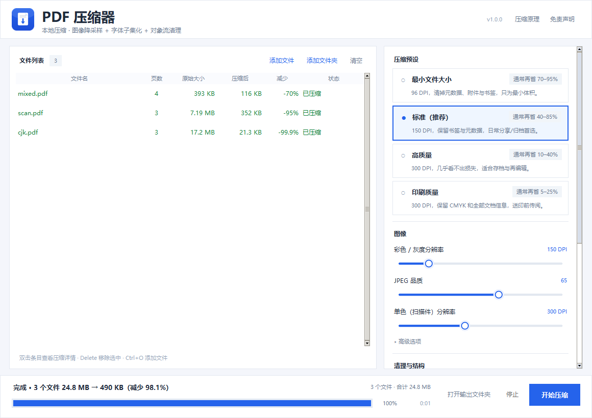
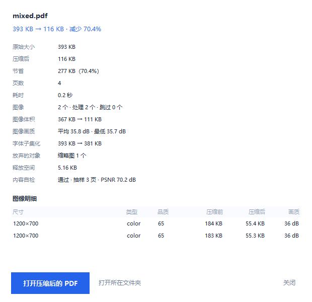

# PDF 压缩器

Windows / macOS 本地小工具：把 PDF 压小。做法是图像降采样与重压缩、字体子集化、结构清理。

拖进来 → 选一档 → 开始压缩。全程离线，文件不上传。



> **English:** An offline PDF compressor for Windows and macOS — image downsampling
> (bicubic/average/subsampling), JPEG/CCITT G4 re-encoding, font subsetting, discarding
> metadata/thumbnails/attachments, object streams and Flate recompression.
> Ships with a tkinter GUI, a CLI, a self-test suite, and a per-image PSNR quality gate.
> **Provided for study and technical exchange only, not as a commercial product. Compression is lossy:
> use it only on documents you are entitled to process and always keep the original.**

> [!IMPORTANT]
> **特别说明（请先阅读）· 本项目仅供学习、研究与技术交流使用，不是商业产品，也不构成任何形式的服务承诺。**
> **继续下载、安装或使用即表示你已阅读并同意以下内容；首次启动需完整输入一句确认语句才可使用，如不同意请停止使用并删除本软件。**
>
> - 请只压缩你**拥有合法权利**的文档，并遵守所在地法律法规；不要处理他人的受版权保护、涉密或受法律法规限制的材料。
> - 本工具不提供破解加密、绕过 DRM 或规避授权限制的功能；遇到加密或受保护的文档会直接拒绝。
> - 压缩全程在本机完成：**不联网、不上传文件、不收集任何数据**。
> - 压缩属于**有损处理**：图像会被降采样并重新编码，元数据/书签/注释/附件等可能按设置被移除。软件按「现状」（AS IS）提供，不担保压缩结果完全符合预期；**重要文件请先备份原件并人工复核**。
> - 因使用或无法使用本软件产生的任何直接或间接损失，由你自行承担，开发者与贡献者不承担责任。
> - 本项目为个人开源项目，与所使用第三方组件的所有者无任何隶属、赞助或背书关系；相关商标归各自所有者。
> - 完整条款见 [DISCLAIMER.md](DISCLAIMER.md)（共 11 节）；代码以 [MIT](LICENSE) 授权（PyMuPDF 为 AGPL-3.0，分发二进制需自行合规）。

## 它到底做了什么

| 做了什么 | 具体实现 | 典型收益 |
| --- | --- | --- |
| **缩减像素采样**：双立方 / 平均 / 次采样，只有超过目标 1.5 倍才降 | 按「像素数 ÷ 页面显示尺寸」算有效 DPI；低于目标 1.5 倍的图不动 | 扫描件体积直接按面积平方下降 |
| **图像重新压缩**：JPEG / ZIP / CCITT G4 / JBIG2 | 彩色灰度 JPEG；单色在 CCITT G4 与 ZIP 之间取更小的那个 | 单色扫描件常见再省 30–70% |
| **仅嵌入使用中的字符子集** | MuPDF + fontTools 字体子集化 | 全量内嵌中文字体 17 MB → 20 KB |
| **放弃的对象**：元数据、缩略图、附件、书签、注释、结构树 | 逐项可勾选，按需删除 | 小的几十 KB，大的看附件 |
| **取消嵌入标准 14 字体** | 只删 Helvetica/Times/Courier 等 14 种标准字体的嵌入数据，保留宽度表 | 每个几千字节 |
| **对象流 + 重新压缩 Flate** | qpdf 对象流、zlib 重压、可选线性化 | 纯文字文档常见 80–90% |
| **画质闸门** | 每张图压完算 PSNR，不达标自动提品质重来，仍不达标就放弃替换 | 避免「压完糊成一片」 |
| **压缩后自检** | 抽样渲染源文件与输出，比页数、墨量、PSNR，异常则放弃输出 | 不会悄悄产出一个坏文件 |

## 四档预设

| 预设 | 彩色/灰度 | JPEG 品质 | 单色 | 清理 | 适合 |
| --- | --- | --- | --- | --- | --- |
| **最小文件大小** | 96 DPI | 45 / 50 | 200 DPI G4 | 删元数据、缩略图、附件、书签、结构树；取消嵌入标准 14 字体 | 邮件、上传、手机看 |
| **标准**（推荐） | 150 DPI | 65 / 70 | 300 DPI G4 | 只删缩略图 | 日常分享、归档 |
| **高质量** | 300 DPI | 85 / 88 | 400 DPI G4 | 不删内容 | 存档、再编辑 |
| **印刷质量** | 300 DPI | 92 / 92 | 600 DPI G4 | 全保留；CMYK 原样保留 | 送印前传阅 |

滑块和勾选项随时可以改成「自定义」，预设区会标记「自定义」。

## 下载与安装

安装包和绿色版放在 [Releases](../../releases/latest) 里（仓库只放源码）：

| 版本 | 文件 | 说明 |
| --- | --- | --- |
| **Windows 安装版** | `PDFCompressor-1.0.0-Setup.exe` | 推荐。双击安装，自动建开始菜单/桌面快捷方式，`Win+R` 输入 `PDFCompressor` 可直接启动，可在「应用」里卸载 |
| **Windows 绿色版** | `PDFCompressor-1.0.0-Portable.zip` | 解压到任意文件夹（建议英文路径），双击 `PDFCompressor.exe` 即用，不写注册表 |
| **macOS 安装版** | `PDFCompressor-1.0.0-macOS-<arch>.dmg` | 打开后把图标拖进「应用程序」即可（需自行构建，见下文） |
| **macOS 绿色版** | `PDFCompressor-1.0.0-macOS-<arch>-Portable.zip` | 解压得到 `PDFCompressor.app`，放哪都能运行（需自行构建） |

Windows 安装包细节：

- 默认**只装给当前用户**（`%LOCALAPPDATA%\Programs\PDFCompressor`），不需要管理员、不弹 UAC；
  安装向导里也可以切到「为所有用户安装」。
- 卸载时会问要不要一并删掉 `%APPDATA%\PDFCompressor` 里的设置（默认保留，回车不会误删）。
- 没有数字签名，Windows 可能提示「Windows 已保护你的电脑」→ 点「更多信息 → 仍要运行」。
- 绿色版和安装版共用同一套设置文件，换版本不用重新调参数。

> **首次启动会先弹出免责声明**：读完后把那段话完整输入一遍，「同意」才会变亮；
> 点「退出」或直接关窗则程序立即关闭。确认一次后不再询问（声明版本更新后会重新询问）。
> 程序右上角随时可以点「免责声明」再读一遍。


macOS 说明：

- macOS 版必须在 **Mac 上**构建（PyInstaller 不能交叉编译），仓库带了 `build-macos.sh` 和
  GitHub Actions 工作流，跑一遍就有 `.dmg` 和 `.zip`。
- 产物未签名/未公证，首次打开请**右键 →「打开」**；若提示已损坏，执行
  `xattr -dr com.apple.quarantine /Applications/PDFCompressor.app`。
- Apple 芯片（arm64）与 Intel（x64）分别打包，互不通用。

发布产物的体积与校验值（`dist/SHA256SUMS.txt` 由 `release.ps1` 生成）：

| 文件 | 大小 |
| --- | --- |
| `PDFCompressor-1.0.0-Setup.exe` | ≈ 42 MB |
| `PDFCompressor-1.0.0-Portable.zip` | ≈ 59 MB |
| `PDFCompressor-1.0.0-macOS-<arch>.dmg` | 需在 Mac 上生成 |
| `PDFCompressor-1.0.0-macOS-<arch>-Portable.zip` | 需在 Mac 上生成 |

`build/`、`dist/`、`installer/output/` 都是本地构建目录，已写进 `.gitignore`，不进仓库。

## 平台支持

| 系统 | 状态 |
| --- | --- |
| Windows 10 / 11（x64） | ✅ 已构建并实测：目录版、绿色版 zip、安装包（装/卸都验过） |
| macOS 11+（Apple 芯片 / Intel） | 🟡 代码已适配（设置目录、打开文件、窗口图标、拖拽均按平台处理），构建脚本与 CI 就绪；需要在一台 Mac 上执行，Windows 无法产出 macOS 产物 |
| Linux | 🟡 源码可直接跑（`python app.py` 或 `cli.py`），未做打包 |

## 从源码运行

需要 Python 3.10+（Windows 上装的是 3.14，macOS 建议 3.11+）：

```powershell
pip install -r requirements.txt
python app.py
```

### 命令行

```powershell
python cli.py 报告.pdf                                  # 标准预设，输出到同目录
python cli.py 扫描件1.pdf 扫描件2.pdf -o D:\out --preset smallest
python cli.py 资料\ --recursive -o out --preset standard
python cli.py 报告.pdf --dry-run                        # 只体检，看体积花在哪
python cli.py 报告.pdf --dpi 200 --quality 75 --gray     # 手动指定参数
python cli.py 一批\ -o out --json                       # 机器可读摘要
```

常用开关：`--preset {smallest,standard,high,print}`、`--dpi`、`--quality`、`--mono-dpi`、
`--gray`、`--no-fonts`、`--strip metadata,outlines,...`、`--keep-everything`、
`--no-object-streams`、`--linearize`、`--overwrite`、`--dry-run`、`--json`。

## 自己打包

**Windows（exe + 绿色版 zip）**

```powershell
powershell -ExecutionPolicy Bypass -File build.ps1
# 产物：dist\PDFCompressor\ 与 dist\PDFCompressor-<版本>-Portable.zip
```

**Windows 安装包**

```powershell
powershell -ExecutionPolicy Bypass -File installer\build_installer.ps1
# 产物：installer\output\PDFCompressor-<版本>-Setup.exe
```

编译器会自动找本机的 Inno Setup 6/7；找不到就下载便携版到
`%LOCALAPPDATA%\PDFCompressor-buildtools`（不需要管理员）。也可以用 `-IsccPath` 指定。

**一条命令出全部**

```powershell
powershell -ExecutionPolicy Bypass -File release.ps1
# 额外生成 dist\SHA256SUMS.txt
```

**macOS**

```bash
bash build-macos.sh            # .app + Portable.zip + .dmg
bash build-macos.sh --no-dmg   # 只要 .app 和 zip
```

需要一个带 Tk 的 Python（系统自带的 `/usr/bin/python3` 通常没有 tkinter）：
装 python.org 的官方安装包，或 `brew install python@3.12 python-tk@3.12`。
脚本会自己建 `.venv-build` 虚拟环境、装依赖、打包、ad-hoc 签名，最后出 dmg。

**CI**

`.github/workflows/build.yml` 会在 `windows-latest`、`macos-14`（Apple 芯片）、
`macos-13`（Intel）上分别构建并上传产物，打 `v*` 标签或手动触发即可。

## 实测

**一个 170 MB / 18 页的效果图排版 PDF**（图片密集、300 DPI 上下，普普通通的真实文件）：

| 预设 | 输出体积 | 减少 | 用时 |
| --- | --- | --- | --- |
| 最小文件大小 | **3.38 MB** | 98.0% | 19 s |
| 标准 | **12.7 MB** | 92.5% | 23 s |
| 高质量 | **101 MB** | 40.6% | 31 s |
| 印刷质量 | **133 MB** | 21.7% | 29 s |

标准档输出抽样渲染对比：18 页页数一致，PSNR 37.1 / 30.1 dB（第 10、18 页），
墨量 0.366→0.366、0.711→0.712 —— 肉眼基本看不出差别。

**自测样例（标准预设）**：

| 样例 | 原始 | 压缩后 | 减少 | 渲染 PSNR |
| --- | --- | --- | --- | --- |
| 彩色扫描件 3 页 300 DPI | 7.19 MB | 352 KB | 95.2% | 37.3 dB |
| 内嵌中文字体（全量嵌入） | 17.2 MB | 21.3 KB | 99.9% | 无损 |
| CMYK 图片（反相存储） | 178 KB | 62 KB | 65.1% | 76.1 dB |
| 混合文档（书签/注释/附件/缩略图） | 393 KB | 116 KB | 70.4% | 70.2 dB |
| 透明图像（SMask） | 81 KB | 29 KB | 63.6% | 54.4 dB |
| 纯文字矢量 12 页 | 83 KB | 9 KB | 89.7% | 无损 |
| 单色扫描（1-bit Flate） | 21.4 KB | 21.4 KB | 已是最优 | — |

`python selftest.py --all` 的 32 个「样例 × 预设」组合全部通过。

压完双击条目能看到每一张图换掉了多少、画质掉了多少：



## 压缩原理

压缩分五步，每一步都能在界面上单独控制：

**1. 体检。** 先算清楚体积花在哪：图像多少、字体多少、内容流多少、元数据/缩略图/附件多少。
图像的有效分辨率按 `像素数 ÷ 页面上的显示尺寸` 算 —— PDF 里标的 DPI 经常是错的，
按那个降采样会误伤。

**2. 字体子集化。** 内嵌字体只保留文档真正用到的字形。这是中文 PDF 最狠的一招：
一份全量内嵌的宋体十几兆，子集化后常常只剩几十 KB。

**3. 图像重压缩。** 只有有效分辨率超过目标 1.5 倍才降采样（1.5 倍规则），
避免把本来就不大的图压糊。彩色/灰度走 JPEG，单色在 CCITT G4 和 ZIP 里挑更小的。
替换的是图像流本身，页面的变换矩阵一个字节都不动，所以位置、大小、裁剪都不会变。

**4. 结构清理。** 按设置删除元数据/缩略图/附件/书签/注释/结构树，取消嵌入标准 14 字体，
重新压缩 Flate 流；可选对象流压缩（PDF 1.5+）和线性化。

**5. 自检。** 把源文件和输出各渲染几页，比页数、墨量、PSNR。页数不一致、整页变白、
整体变色都会被拦下来，然后**不落盘**。

## 为什么不会压坏

- **版面不动**：只换图像流，不碰 `cm` 矩阵、不重排文字。
- **1.5 倍规则**：只有「明显超采样」的图才降，120 DPI 的图不会被拉到 96。
- **体积护栏**：重压缩后体积没比原来小 5% 以上，就保留原图。
- **画质闸门**：每张图算 PSNR，低于阈值先提高品质重试，仍不行就放弃替换。
- **文档级自检**：渲染比对，异常就丢掉输出，宁可给你一个「失败」也不给一个坏文件。
- **自动保底**：整份文件压完反而更大时，输出原文件的副本并标注「已是最优」。

## 限制

- **加密 PDF**：设置了打开密码的会拒绝；只有权限密码的可在设置里允许解密后压缩。
- **JBIG2 图像**：跳过（无法安全重编码）。
- **内联图像**（inline image）：不处理，原样保留。
- **CMYK**：默认原样保留颜色；选「转为 RGB」体积更小但颜色可能有轻微偏移。
- **透明拼合**（flatten transparency）：没有实现。
- **单线程**：一张一张压，几百页的扫描件会慢（有进度条，可以中途停）。

## 目录结构

```
PDFCompressor/
├─ app.py                     # 图形界面（tkinter，Windows/macOS 通用）
├─ cli.py                     # 命令行
├─ selftest.py                # 自测：造 8 类样例 × 4 档预设，校验体积/页数/文字/画质
├─ make_icon.py               # 生成 icon.ico / icon.png / icon.icns
├─ DISCLAIMER.md              # 免责声明（11 节，随程序分发）
├─ build.ps1                  # Windows：exe + 绿色版 zip
├─ release.ps1                # Windows：一键出 exe/zip/安装包 + SHA256SUMS
├─ build-macos.sh             # macOS：.app + zip + dmg
├─ PDFCompressor.spec         # PyInstaller（Windows）
├─ PDFCompressor-macos.spec   # PyInstaller（macOS，产出 .app）
├─ assets/                    # 图标
├─ installer/
│  ├─ PDFCompressor.iss       # Inno Setup 安装包脚本
│  ├─ build_installer.ps1     # 编译安装包（自动找/下载 Inno Setup）
│  └─ languages/              # 简体中文安装界面
├─ .github/workflows/build.yml  # CI：Windows + macOS(arm64/x64) 全打包
├─ dist/                      # 本地构建产物（不进仓库）
└─ engine/
   ├─ analyze.py              # 体检：页面/图像/字体/元数据
   ├─ imageopt.py             # 图像降采样 + 重编码 + PSNR 闸门
   ├─ fonts.py                # 字体子集化
   ├─ structure.py            # 放弃对象 / 对象流 / 线性化
   ├─ verify.py               # 压缩后渲染自检
   ├─ pipeline.py             # 把上面几步串起来
   └─ settings.py             # 参数与四档预设
```

## 自测

```powershell
python selftest.py          # 8 类样例 × 3 档预设
python selftest.py --all    # 跑满 4 档
python selftest.py --keep   # 保留 _testdata 里的样例和输出，方便人工看
```

样例覆盖：彩色扫描件、内嵌中文字体、1-bit 单色扫描、`/Decode` 反相单色图、
CMYK 反相存储、带书签/注释/附件/缩略图的混合文档、带 SMask 的透明图、纯文字矢量文档。
断言包括：页数一致、文字保留 ≥90%、体积确实变小、渲染 PSNR 达标、该删的东西确实删了。

## 免责声明

- 本项目**仅供学习、研究与技术交流**，不是商业产品，也不提供任何服务承诺或技术支持义务。
- 请只处理你**拥有合法权利**的文件，并遵守所在地法律法规；不处理他人版权保护、涉密或受限材料。
- 压缩是**有损处理**，且会按设置删除部分文档内容；重要文件请**备份原件并人工复核**。
- 全程本机运行：不联网、不上传、不收集任何数据。
- 软件按「现状」提供，因使用产生的任何直接或间接损失由你自行承担。
- 为个人开源项目，与所使用第三方组件的所有者无隶属或背书关系，相关商标归各自所有者。

完整条款（11 节 + English summary）见 [DISCLAIMER.md](DISCLAIMER.md)。

## 许可

MIT（第三方组件遵循各自协议，其中 **PyMuPDF 为 AGPL-3.0**，分发二进制请自行确认合规）。
